<p align="center">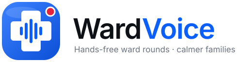</p>

# WardVoice

**Doctors run ward rounds by voice, so they never touch a tablet with gloved hands. Every field is checked twice, and each family gets a plain-language daily update once the doctor signs off.**

Build with Agora, Bengaluru 2026 · Track 3: AI Agents That Get Things Done.

## Demo video

▶️ **[Watch the demo on YouTube](https://youtu.be/REPLACE_WITH_VIDEO_ID)** (9 min): a real voice round recorded live (Agora ConvoAI + Murf Falcon), with a narrated intro and outro. The narration is also generated with Murf Falcon.

| Doctor app | Voice round | Family app | Family email |
|---|---|---|---|
| 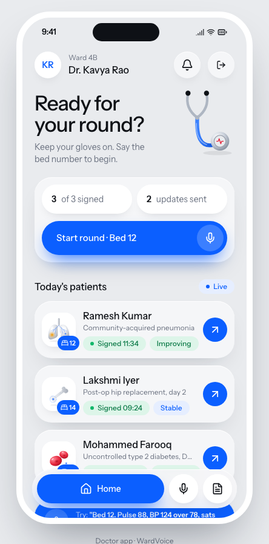 | 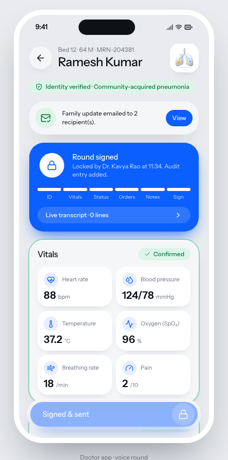 | 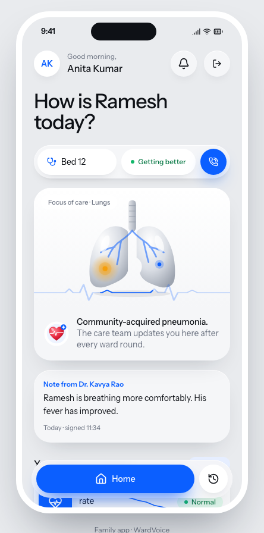 | 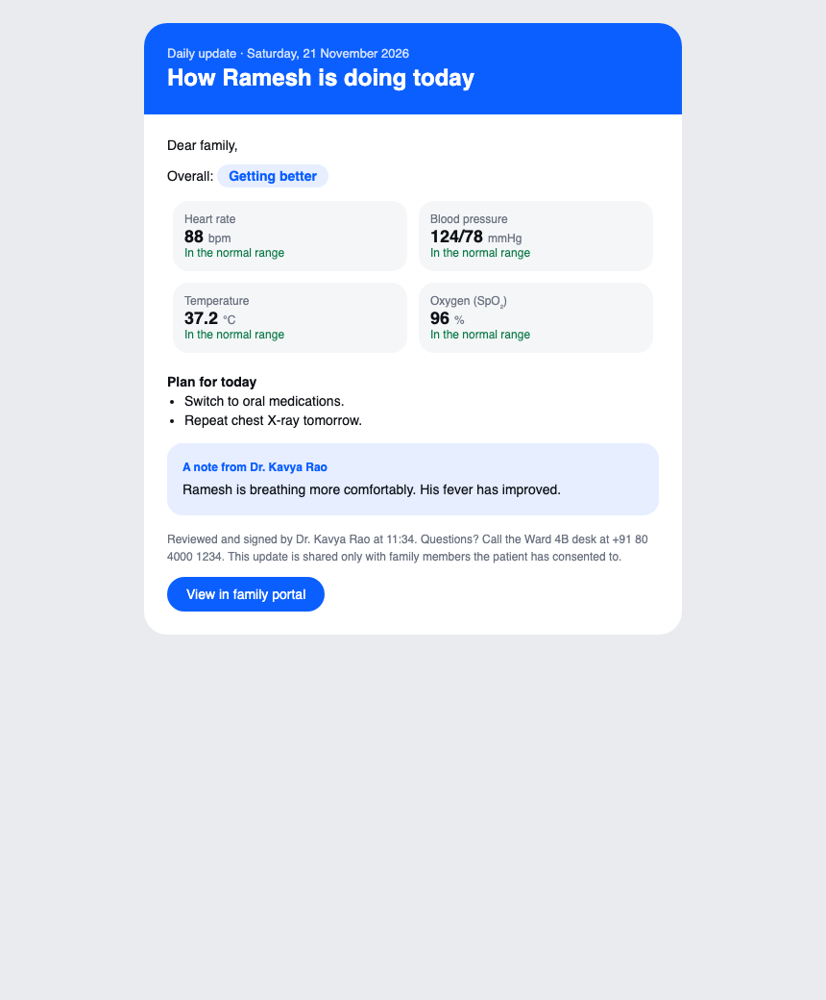 |

## Problem

On a ward round a doctor examines a patient, then has to record vitals, status, orders and notes. In isolation rooms, ICUs and post-op wards that means taking gloves off or touching a shared tablet, a known cross-contamination route, or writing it up later from memory. Meanwhile families phone the nurses' station all day asking "how is he today?", because nobody has time to tell them.

## Solution

WardVoice is a phone app with two logins:

- **Doctor app.** The doctor says "Bed 12". The agent reads back the name and MRN and waits for "correct" before anything is written. The doctor then dictates naturally ("pulse 88, BP 124 over 78, temp 37.2…"), and the record fills in live on screen: **amber** means captured, **green** means confirmed. Each section is read back and confirmed (layer 1). The whole round is read back before "sign and send" locks it (layer 2).
- **Family app.** After sign-off, consented relatives get a plain-language update by email and in the app: condition, the doctor's note for the family, vitals and the plan. The internal clinical note is never sent.

Safeguards built into the tools, not just the prompt:
- Nothing is written before the identity is confirmed.
- Vitals are range-checked: impossible values are rejected, abnormal ones are flagged for a re-check, and °F is converted to °C.
- Condition, consciousness, diet and mobility only accept values from fixed lists. Orders are typed (kind and action). Only the two notes are free text.
- **Deteriorating or critical:** the family email is held and the patient is added to the doctor's "call the family" list. Bad news is never delivered by email.
- **No consent on file:** nothing is sent.
- Every change is audit-logged with `via=voice` or `via=touch`. Every field also has a touch fallback that follows the same rules.

## Agentic workflow (Track 3: Initiate → Plan → Execute → Adapt → Confirm)

| Stage | What happens |
|---|---|
| Initiate | The doctor speaks over Agora RTC: "Bed 12." |
| Plan | The LLM maps speech to the round's fixed sequence (identity → vitals → status → orders → notes → sign) and works out which section each utterance belongs to. |
| Execute | MCP tool calls: `select_patient`, `confirm_identity`, `record_vitals`, `set_status`, `add_order`, `set_notes`, `confirm_section`, `read_back`, `sign_and_send`. A typical round makes 12 or more coordinated calls. |
| Adapt | Tools refuse or flag: implausible vitals, writes before identity is confirmed, an unknown bed, signing with unconfirmed sections. They return `out_of_range` flags for abnormal values, and hold the email for critical patients. The agent asks the doctor to re-check or confirm instead of guessing. Touch edits revert a section to amber. |
| Confirm and follow up | `sign_and_send` requires explicit doctor confirmation. It locks the record, writes the audit entry, builds the family report, and emails consented relatives (or holds it). |

## Agora integration

- **Agora Conversational AI Engine** runs the voice agent: Deepgram nova-3 STT → OpenAI LLM (Agora-managed) → **Murf Falcon TTS**, started from `server/src/agent.py` with the `agora-agents` SDK.
- **Agora RTC** carries the doctor's mic and the agent's voice inside the round screen (`web/src/wardvoice/VoiceSessionLive.tsx`, `agora-rtc-react`).
- **Agora RTM + `agora-agent-client-toolkit`** stream the live transcript and agent state (listening / thinking / speaking) into the doctor's screen.
- **MCP tool calling:** the agent is started with `mcp_servers` pointing at our FastMCP server (`server/src/mcp_server.py`, mounted at `/mcp` in the same FastAPI process). Agora cloud calls it for every tool call.

## Murf AI integration

- Every word the agent speaks uses **Murf Falcon** streaming TTS (`MurfTTS`, `model=FALCON`, Indian English voice), configured in `server/src/agent.py`.
- The agent **refuses to start without `MURF_API_KEY`**, so it never silently falls back to another voice. The fallback exists only for local testing, behind `ALLOW_TTS_FALLBACK=1`.
- Falcon's low latency matters here: per-section read-backs are spoken often, so a slow voice would stall the round.

## Screens

| Landing | Sign in | Doctor home | Voice round (signed) |
|---|---|---|---|
| 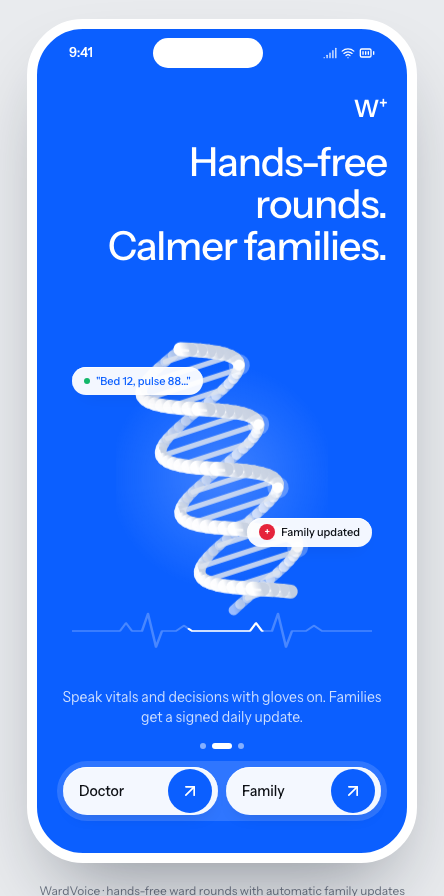 | 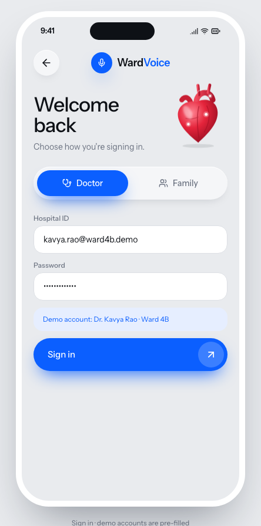 |  |  |

| Family reports (doctor) | Family home | Daily updates | Email |
|---|---|---|---|
| 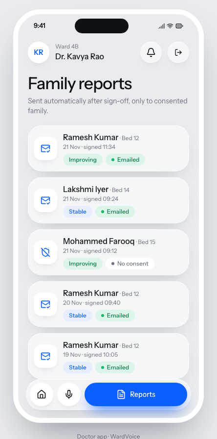 |  | 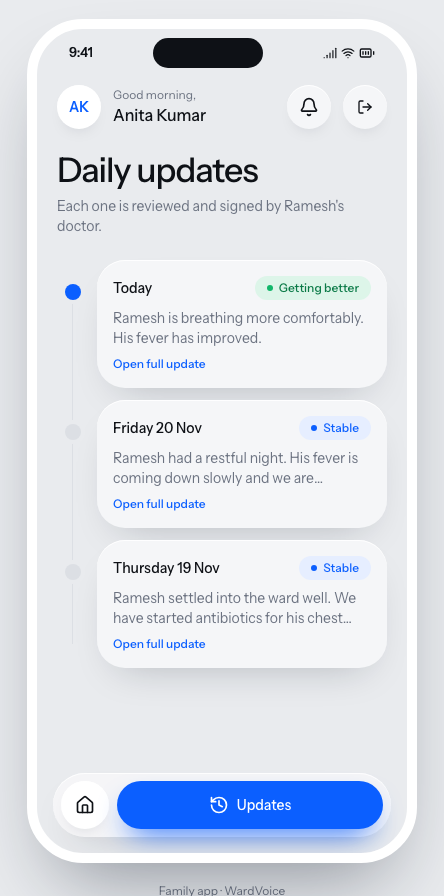 |  |

Design language: light neumorphic cards (`#E9EBEE` / `#F5F6F8`), primary blue `#0B5FFF`, **amber = captured**, **green = confirmed**, red only for critical or out-of-range values; 28px radius, pill buttons, Instrument Sans display type. Tokens live in `web/tailwind.config.js` (`colors.wv.*`).

**Design catalogue:** [docs/DESIGN.md](docs/DESIGN.md) has the logo, colour and type, every illustration (DNA helix, heart, lungs, hip bone, blood cells, stethoscope, ECG, care badge) and where each one is used.

|  |  |  |  |  |  |  |
|---|---|---|---|---|---|---|

## Tech stack

| Layer | Technology | Role |
|---|---|---|
| Voice agent | **Agora Conversational AI Engine** | Turn-taking, interruptions, STT → LLM → TTS pipeline, MCP tool calls |
| Real-time audio | **Agora RTC** (`agora-rtc-react`) | Doctor's mic and agent voice in the round screen |
| Transcript / state | **Agora RTM** + `agora-agent-client-toolkit` | Live transcript, listening / thinking / speaking |
| Speech-to-text | Deepgram nova-3 (Agora-managed) | |
| LLM | OpenAI `gpt-4o-mini` (Agora-managed) | Plans and calls the tools |
| Text-to-speech | **Murf Falcon** (`en-IN-priya`) | Every spoken read-back |
| Tools | FastMCP (`server/src/mcp_server.py`) | 11 ward-round tools at `/mcp` |
| Backend | FastAPI + `agora-agents` SDK | Tokens, agent lifecycle, ward record, REST, email |
| Frontend | Next.js 16, React 19, Tailwind | Doctor and family phone apps |
| Email | Resend or SMTP (preview-only fallback) | Family update after sign-off |

## Architecture

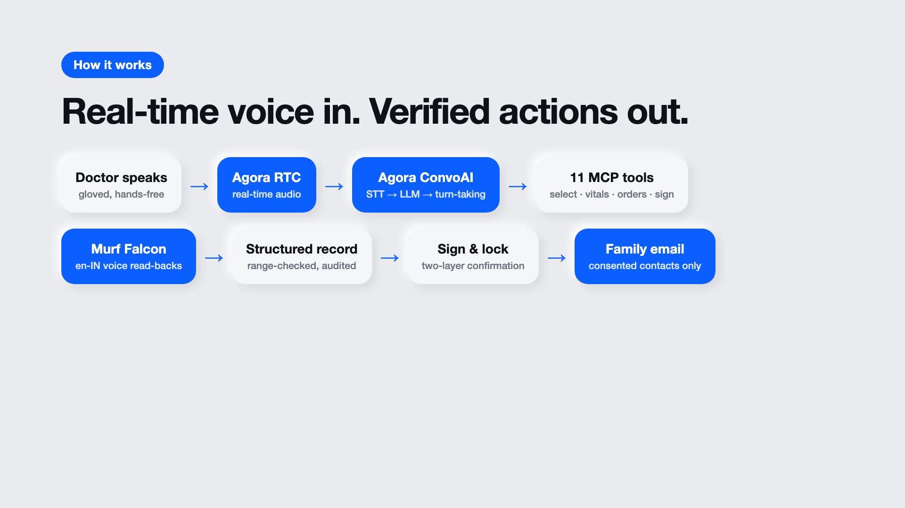

```
Doctor phone app (Next.js)                    Family phone app (Next.js)
  │ RTC mic/voice · RTM transcript               │ GET /ward/state
  ▼                                              ▼
Agora ConvoAI cloud ── tool calls ──▶ FastAPI backend (:8000)
  Deepgram → LLM → Murf Falcon        ├─ /mcp       FastMCP tools (ward round)
                                      ├─ /ward/*    state, touch actions, email preview
                                      ├─ /startAgent /stopAgent /get_config
                                      └─ ward.py    validation, sign-off, audit, report, email
```

The UI polls `/ward/state`, so tiles change colour the moment a tool call lands.

## Run it

```bash
bun run setup                                   # venv + web deps
# server/.env.local: AGORA_APP_ID, AGORA_APP_CERTIFICATE, MURF_API_KEY
cloudflared tunnel --url http://localhost:8000  # Agora cloud must reach /mcp
# set MCP_ENDPOINT=https://<tunnel>.trycloudflare.com/mcp, then:
bun run dev                                     # backend :8000 + web :3000
```

- Doctor app: `/doctor/round/P1?as=doctor`. Tap **Start voice round** and say "Bed 12".
- Family app: `/family?as=family`
- Reset between demos: `curl -X POST localhost:8000/ward/reset`
- Without a backend, the app runs on offline demo data and labels itself as such.
- Optional real email: `RESEND_API_KEY` (or SMTP) plus `FAMILY_EMAIL_OVERRIDE=<your inbox>`.

Checks:

```bash
cd server && venv/bin/python -m pytest -q                       # unit tests
venv/bin/python scripts/e2e_mcp_round.py https://<tunnel>       # full round over MCP via the public URL
```

Verified on event day: 19/19 backend tests, `bun run verify:web` builds all 9 routes, a full scripted round over the public tunnel passes every adapt check (identity gate, implausible HR rejected, unknown bed, early sign-off blocked, edits blocked after lock, clinical note absent from the family email), and a live voice round was completed end to end (see the demo video).

## Deploy on Render

`render.yaml` is a Render Blueprint for two services: `wardvoice-api` (the Dockerfile: FastAPI + `/mcp`) and `wardvoice-web` (Next.js).

1. Render dashboard → **New → Blueprint** → choose this repo.
2. Enter the secrets it asks for: `AGORA_APP_ID`, `AGORA_APP_CERTIFICATE`, `MURF_API_KEY`.
3. No tunnel is needed: the backend sets `MCP_ENDPOINT` to `RENDER_EXTERNAL_URL/mcp` automatically.
4. If Render renames the API service (e.g. adds a suffix), set `AGENT_BACKEND_URL` on `wardvoice-web` to its URL and redeploy.

Free instances sleep when idle, so open the API URL once about a minute before a demo.

## Future scope

- EHR write-back (FHIR `Observation`, `MedicationRequest`) instead of the in-memory ward.
- Murf voice notes for families in Hindi and Kannada.
- A family voice line that answers only from the signed summary.
- Auto-generated nursing shift handover.
- Hospital SSO and per-ward consent management.

Built on Agora's `recipe-agent-mcp` starter (MIT). See [PLAN.md](./PLAN.md) and [DEMO.md](./DEMO.md).
