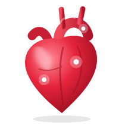
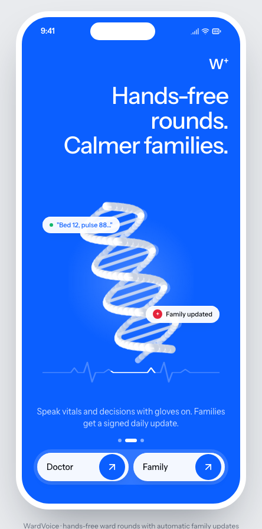
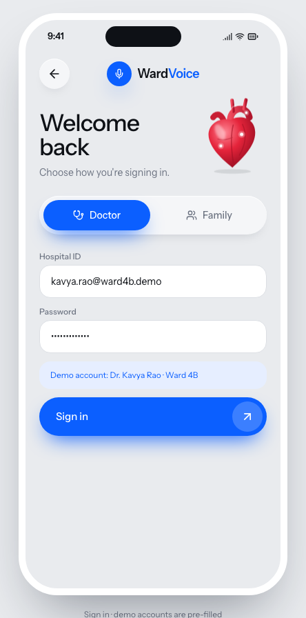
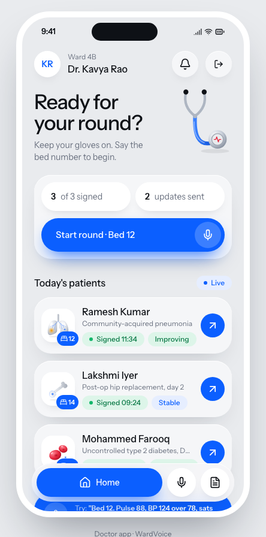
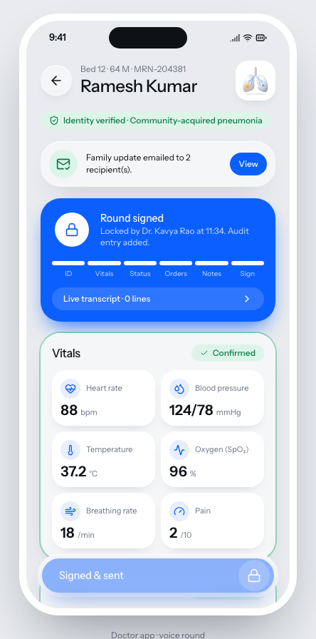
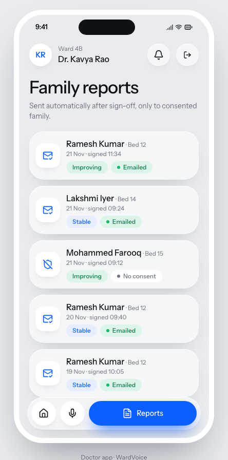
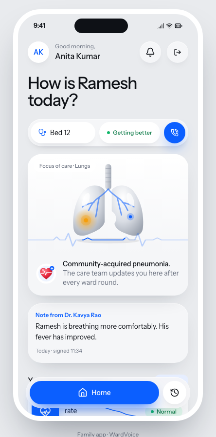
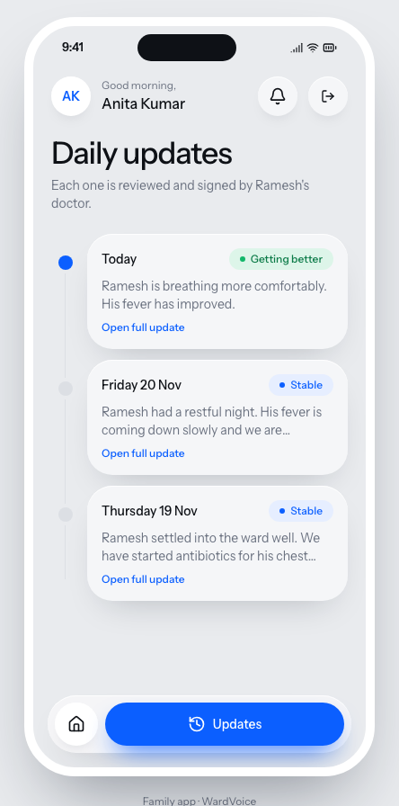
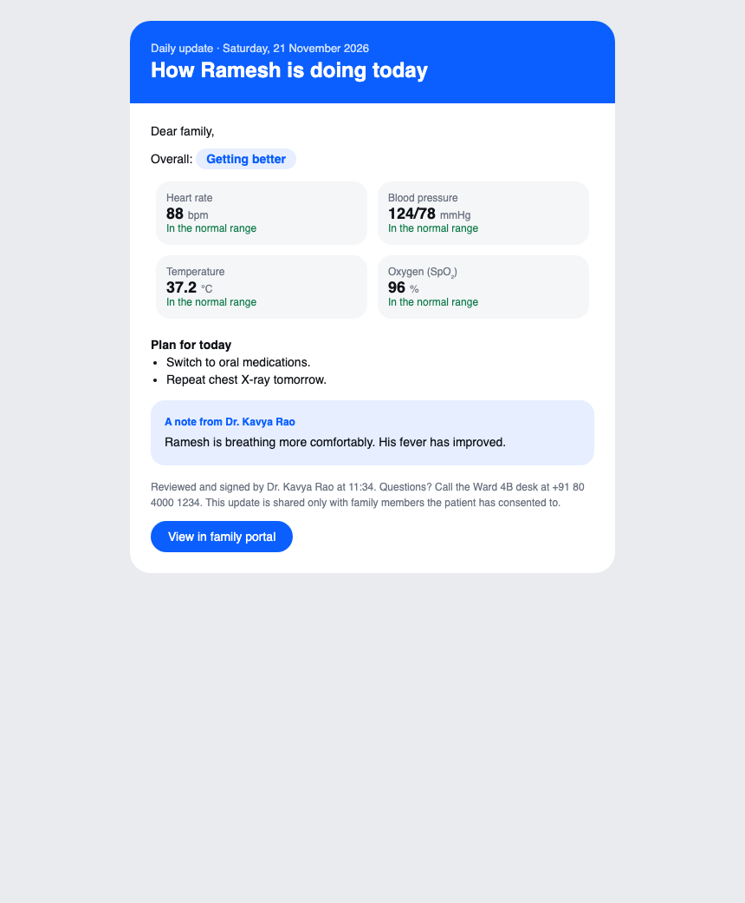

# WardVoice: design catalogue

## Feel
**Clinical, calm, caring.** The doctor's side has to be glanceable mid-examination with gloves on. The family side has to reassure, never alarm. Soft light surfaces, one strong blue, and colour that always means something.

## Logo

| App icon | Full logo |
|---|---|
|  |  |

A **medical cross carrying a voice waveform**: care and voice in one mark. The red dot is the "live" pulse. Files: [`brand/wardvoice-icon.svg`](brand/wardvoice-icon.svg) (also the app favicon) and [`brand/wardvoice-logo.svg`](brand/wardvoice-logo.svg).

## Colour

| Token | Hex | Meaning |
|---|---|---|
| `wv.page` | `#E9EBEE` | Page |
| `wv.card` | `#F5F6F8` | Neumorphic cards |
| `wv.ink` | `#0E1116` | Text |
| `wv.muted` | `#6B7280` | Secondary text |
| `wv.blue` | `#0B5FFF` | Primary, voice, brand |
| `wv.amber` | `#F59E0B` | **Captured** (spoken, not yet confirmed) |
| `wv.green` | `#12B76A` | **Confirmed** (read back and accepted) |
| `wv.red` | `#E5243B` | Only for critical or out-of-range values |

State is never shown by colour alone: every amber or green field also carries a *Captured* or *Confirmed* label. Tokens live in [`web/tailwind.config.js`](../web/tailwind.config.js).

## Shape and type
- 28px card radius, soft double shadows (neumorphic), **pill buttons with a round arrow badge**.
- Bottom tab bar where the active tab becomes a wide blue pill.
- Display: **Instrument Sans**, oversized, tight tracking (−0.03em). Body: the same family at 14–15px.

## Illustration fragments

Hand-built SVG figures in [`web/src/wardvoice/figures.tsx`](../web/src/wardvoice/figures.tsx): soft gradients, a white highlight, a floor shadow and pulsing **hotspot** dots. No raster art, so they stay sharp at any size. Each export below is regenerated with `cd web && bun run scripts/export-figures.tsx`.

| | | | |
|---|---|---|---|
|  **DNA helix** splash hero, with real depth |  **Heart** sign-in, cardiac focus |  **Lungs** pneumonia; the amber glow marks the affected lobe |  **Hip bone** orthopaedic, with a dashed surgical-site ring |
|  **Blood cells** metabolic or diabetes focus |  **Stethoscope** doctor home hero |  **Care badge** heart, ECG and cross: family reassurance |  **ECG trace** animated sweep under heroes |

**Organ by diagnosis.** `OrganFigure` reads the patient's diagnosis and picks lungs, bone, blood cells or heart. Every patient tile, the round header and the family "Focus of care" card show the right organ automatically.

| Where | Fragment |
|---|---|
| Splash | DNA helix, ECG, and the voice and "Family updated" labels |
| Sign in | Heart |
| Doctor home | Stethoscope; organ thumbnail and bed badge on each patient |
| Voice round | Organ tile beside the patient's name |
| Family home | "Focus of care" card: large organ, ECG strip, care badge |

## Motion
- Figures bob gently (`wv-bob`, 4–5 s). The ECG draws a moving pulse (`wv-ecg`, 2.6 s). Hotspots breathe.
- The voice orb pings while listening. Tiles flip amber → green as sections are confirmed.
- All decorative motion uses `motion-safe:`, so it stops when the phone's reduce-motion setting is on.

## Screens

| Landing | Sign in | Doctor home | Voice round |
|---|---|---|---|
|  |  |  |  |

| Family reports | Family home | Daily updates | Email |
|---|---|---|---|
|  |  |  |  |

Inspiration: the soft 3D medical style of the reference shots in [`design/`](../design/).
